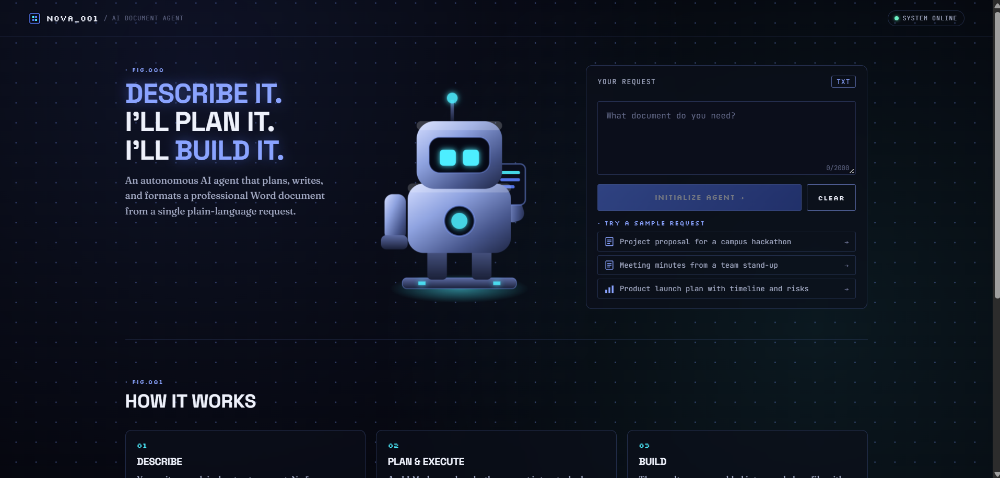
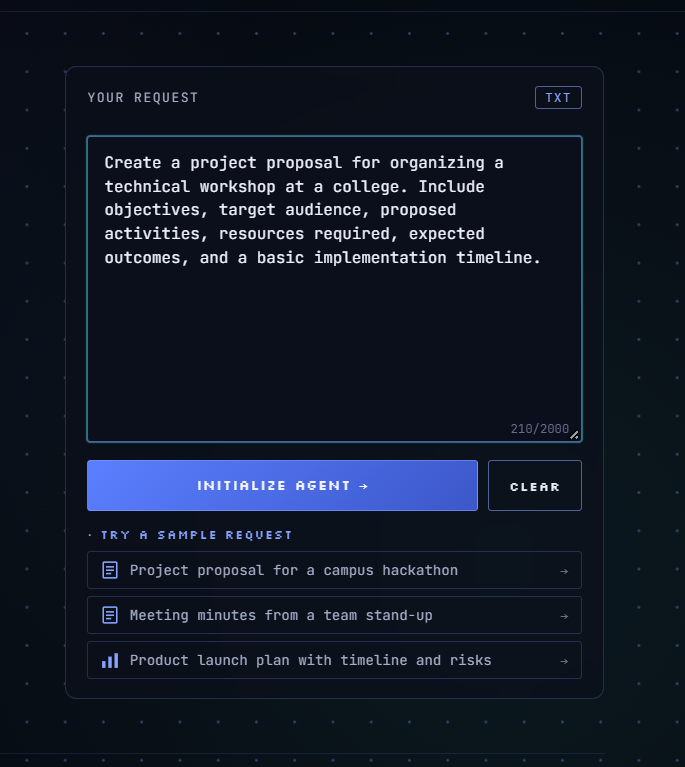
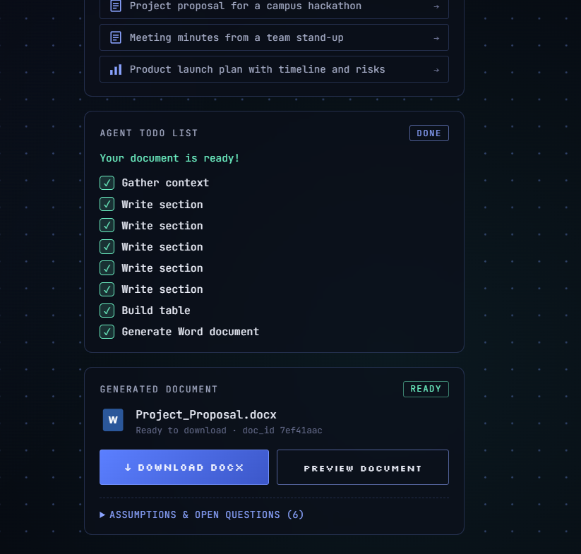
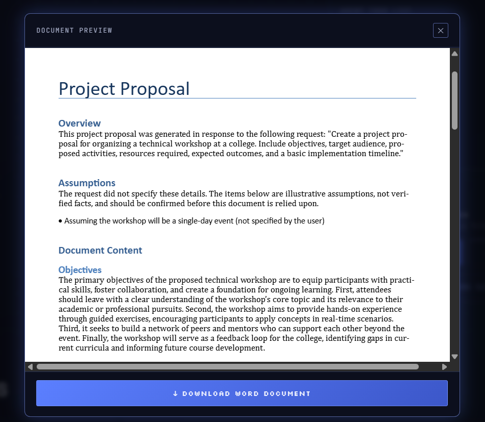
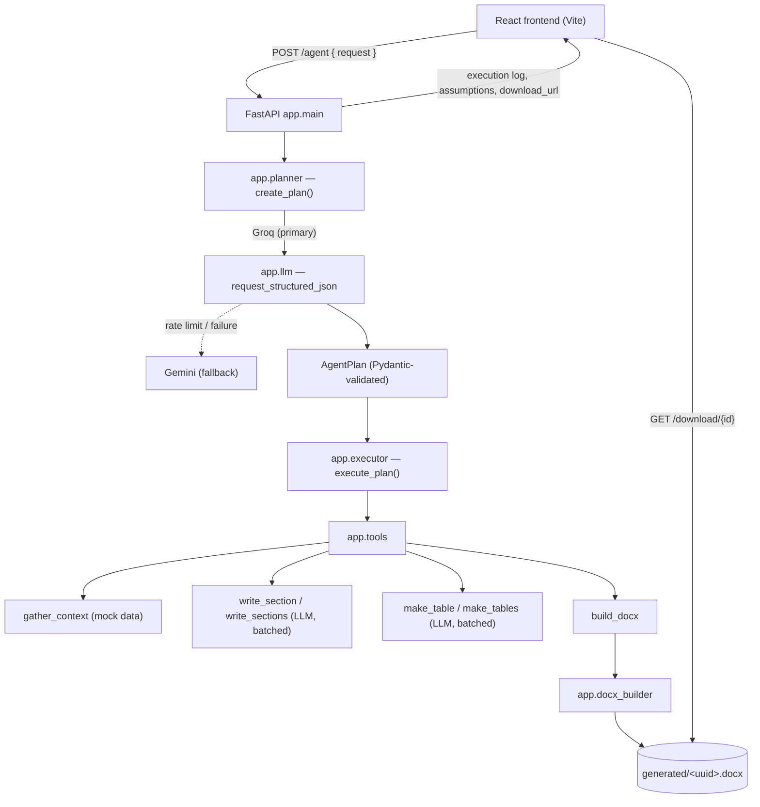

<div align="center">

# NOVA - Autonomous Document Agent

**Describe it. NOVA plans it. NOVA builds it.**

Turn a single plain-language request into a planned, executed, and fully formatted Word document — no templates, no manual drafting.


</div>

---

## What it does

You type one request — for example *"Create a project proposal for a campus hackathon"* — and NOVA:

1. **Plans** the document as a structured, validated task list (sections, tables, etc.) using an LLM.
2. **Executes** that plan step by step through a fixed set of Python tools.
3. **Builds** a real `.docx` file with proper headings, styles, and tables — ready to preview or download.

It's an *agent*, not a chatbot: the LLM decides *what* to do (the plan, the section names, the prose), while deterministic Python code decides *how* it's carried out, validates every step, and stops the run cleanly if anything fails instead of silently producing a broken document.

---

## Screenshots

<div align="center">

### Landing page


<br><br>

<table>
<tr>
<td width="50%" valign="top">

**Request form**


</td>
<td width="50%" valign="top">

**Live task log + generated document**


</td>
</tr>
</table>

<br>

### In-browser document preview


</div>

---

## Architecture



**Request lifecycle:**

| Step | Component | What happens |
|---|---|---|
| 1 | `RequestPanel.jsx` | User submits a plain-language request (max 2,000 chars client-side, 6,000 server-side) |
| 2 | `api.js` | `POST /agent` to the FastAPI backend |
| 3 | `app/planner.py` | Asks the LLM for a structured task plan; validates it with Pydantic; retries once on a schema error |
| 4 | `app/executor.py` | Runs the plan's tasks in order, batching independent `write_section` / `make_table` tasks together |
| 5 | `app/tools.py` | Each tool calls the LLM (sections/tables) or returns deterministic data (`gather_context`) |
| 6 | `app/docx_builder.py` | Deterministically renders the final `.docx` with python-docx — headings, bullet/numbered lists, bold text, and tables |
| 7 | `app/main.py` | Returns the execution log, assumptions, open questions, and a `download_url` |
| 8 | Frontend | Shows the task log, lets the user preview the real file in-browser (via `docx-preview`) or download it |

---

## Tech stack

| Layer | Technology |
|---|---|
| Backend framework | FastAPI + uvicorn |
| Validation | Pydantic v2 |
| LLM providers | Groq (primary), Google Gemini (fallback) |
| Document generation | python-docx |
| Frontend | React 19 + Vite |
| Document preview | docx-preview (renders the real generated file client-side) |
| Testing | pytest (99 tests, all provider calls mocked) |

---

## Project structure

```
Autonomous Agent/
├── app/
│   ├── main.py            # FastAPI app: /health, /agent, /download/{id}
│   ├── planner.py         # LLM-driven task planning + schema correction
│   ├── executor.py        # Runs a validated plan's tasks, batches LLM calls
│   ├── tools.py            # gather_context, write_section(s), make_table(s), build_docx
│   ├── llm.py              # Groq/Gemini client, retry + fallback policy, token caps
│   ├── docx_builder.py     # Deterministic Word document construction
│   ├── models.py           # Pydantic request/response/plan models
│   └── mock_data.py        # Simulated business context used by gather_context
├── tests/                  # 99 tests — planner, executor, tools, llm, docx, API
├── frontend/
│   └── src/
│       ├── components/     # RequestPanel, StatusPanel, DocumentCard, preview modal, ...
│       ├── hooks/          # useDocumentWorkflow, useProgressStages, useHealthStatus
│       └── api.js          # Talks to the FastAPI backend
├── images/                 # Screenshots used in this README
├── requirements.txt
└── .env.example
```

---

## Getting started

### Backend

```bash
# from the project root
.venv\Scripts\activate          # Windows
pip install -r requirements.txt
cp .env.example .env            # then add your GROQ_API_KEY (and optionally GEMINI_API_KEY)
uvicorn app.main:app --reload --port 8000
```

The API is now at `http://127.0.0.1:8000`. Interactive docs are auto-generated by FastAPI:
- Swagger UI → `http://127.0.0.1:8000/docs`
- ReDoc → `http://127.0.0.1:8000/redoc`

### Frontend

```bash
cd frontend
npm install
npm run dev
```

Vite serves the UI at `http://localhost:5173` and talks to the backend at `http://127.0.0.1:8000` by default (override with `VITE_API_BASE_URL`).

### Tests

```bash
pytest -q
```

All 99 tests mock the LLM providers — no live Groq/Gemini calls are made during testing.

---

## API reference

| Method | Path | Description |
|---|---|---|
| `GET` | `/health` | Liveness check — returns `{"status": "ok"}` |
| `POST` | `/agent` | Runs the full pipeline for a `{"request": "..."}` body; returns the plan's `doc_type`, `assumptions`, `open_questions`, `execution_log`, `sections`, `tables`, `document_id`, and `download_url` |
| `GET` | `/download/{document_id}` | Streams the generated `.docx` (id must be a 32-char hex string — anything else is rejected before touching the filesystem) |

## Environment variables

| Variable | Required | Purpose |
|---|---|---|
| `GROQ_API_KEY` | Yes | Primary LLM provider |
| `GROQ_MODEL` | No | Defaults to `llama-3.3-70b-versatile` in code (see `.env.example` for the configured model) |
| `GEMINI_API_KEY` | No | Enables the Gemini fallback when Groq fails or hits a rate limit |
| `GEMINI_FALLBACK_MODEL` | No | Defaults to `gemini-flash-latest` |
| `CORS_ORIGINS` | No | Comma-separated allow-list; defaults to `*` |

---

## Design notes

- **Grounding:** every content-generation prompt separates the user's request, LLM-made assumptions, and simulated business context into clearly labeled blocks, and instructs the model to never invent budgets, vendors, metrics, or dates it wasn't given.
- **Honest failure:** if any task in the plan fails, execution stops immediately — `build_docx` never runs on a partially-failed plan, so a document is never presented as complete when it isn't.
- **Honest progress:** the frontend's step-by-step progress indicator is a timed estimate for UX purposes only; the task list shown after completion reflects the real, backend-reported execution log.
- **Reliability:** Groq rate limits and transient errors fall back to Gemini automatically; a provider's raw error details are logged server-side only and never leaked to the client.

---

## License

No license file is currently included in this repository.
